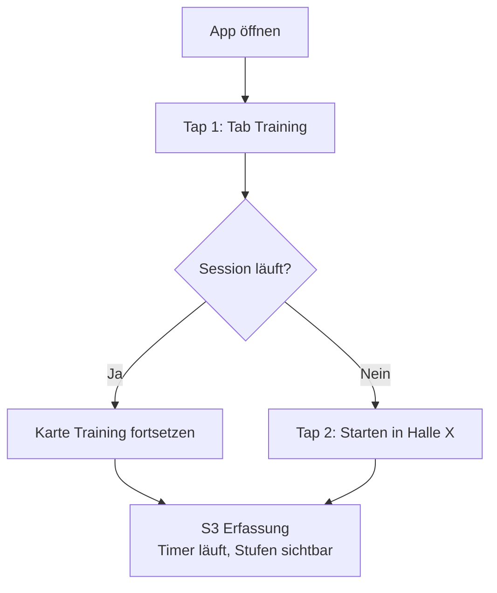
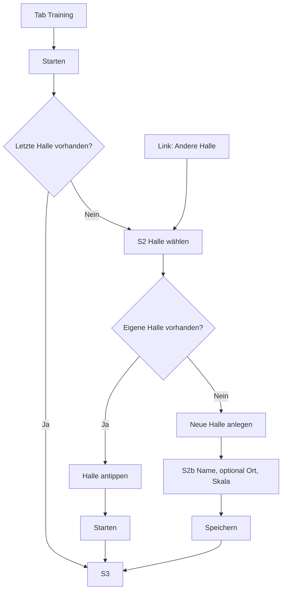
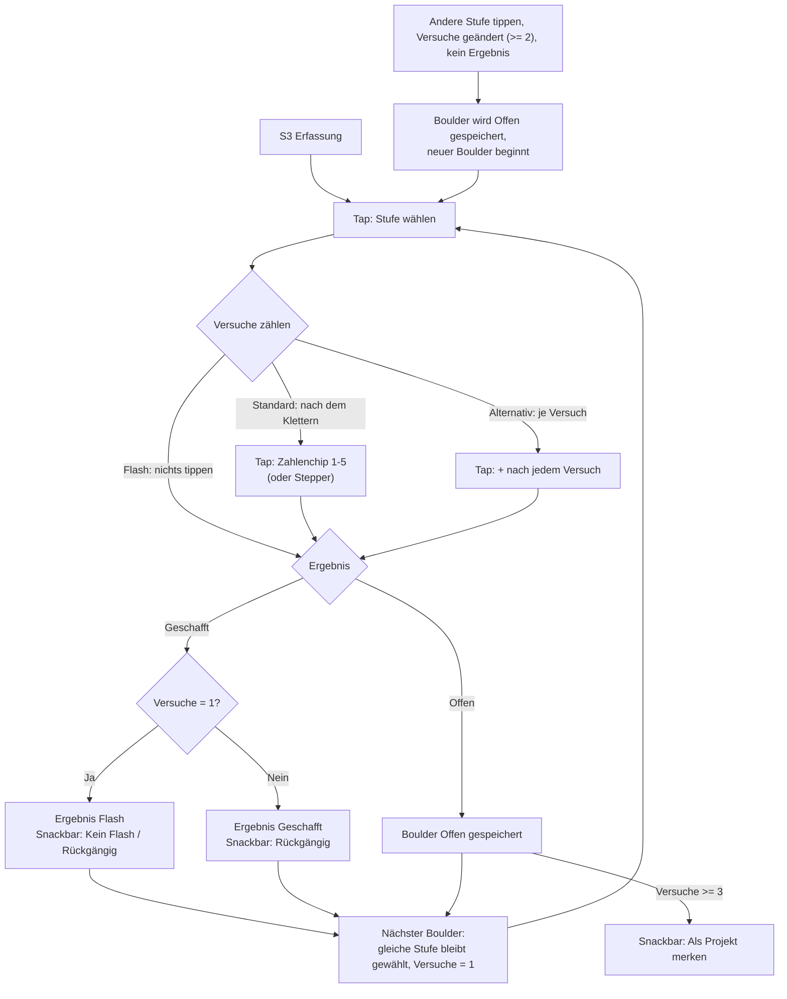
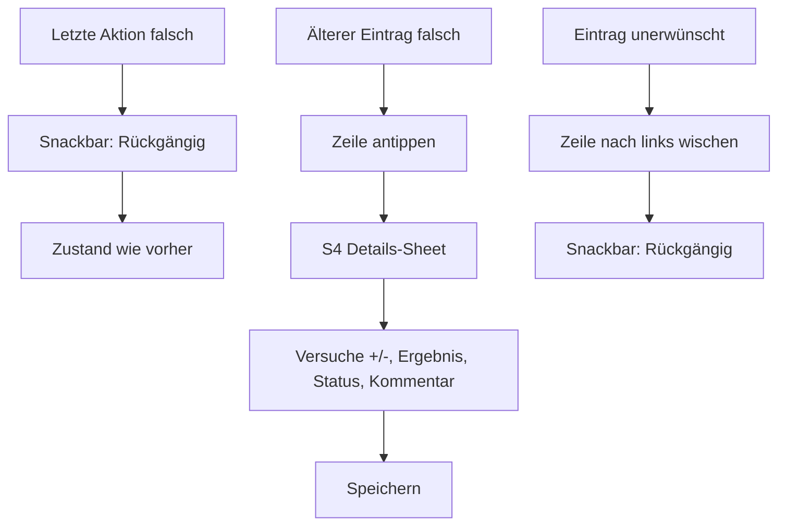
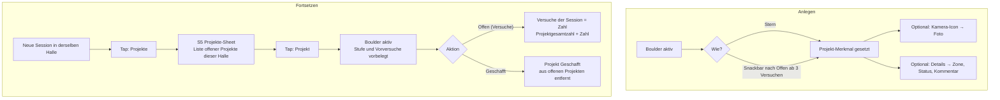
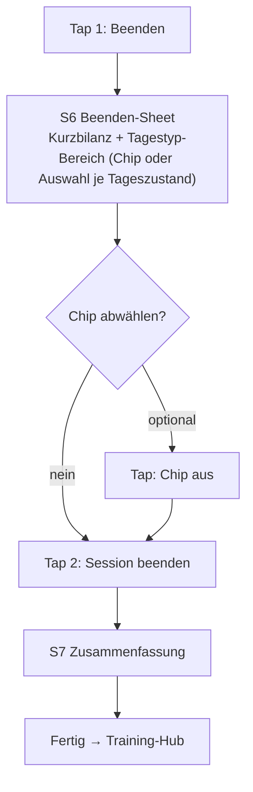
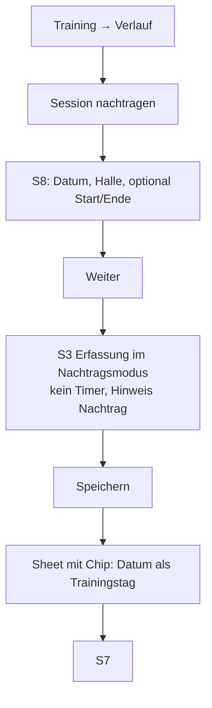
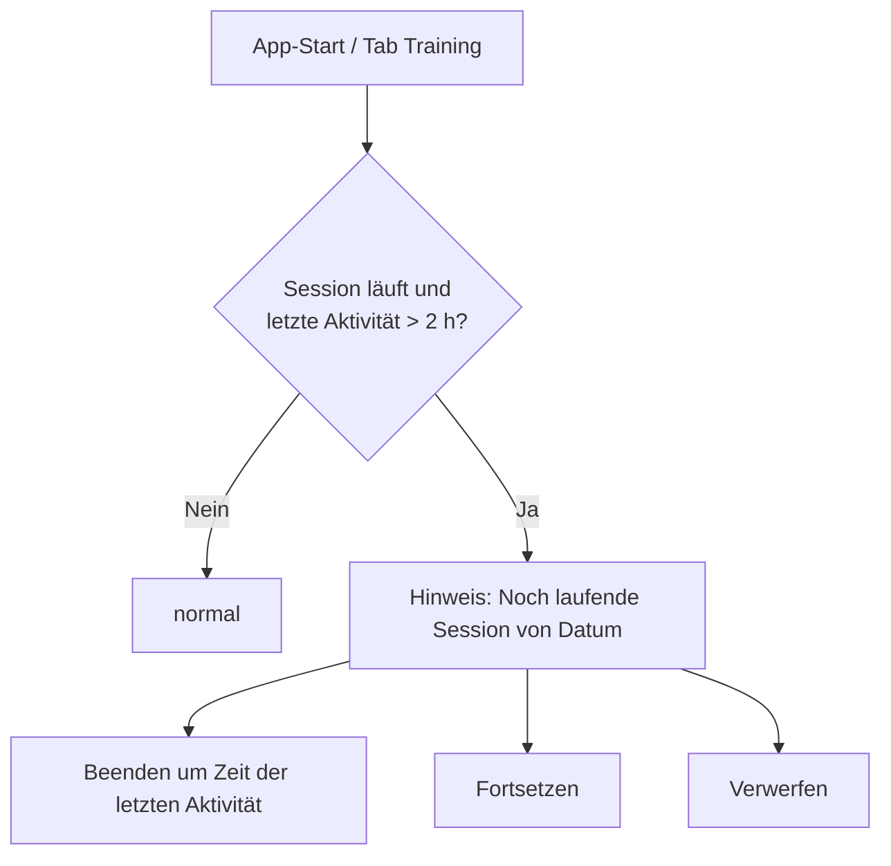
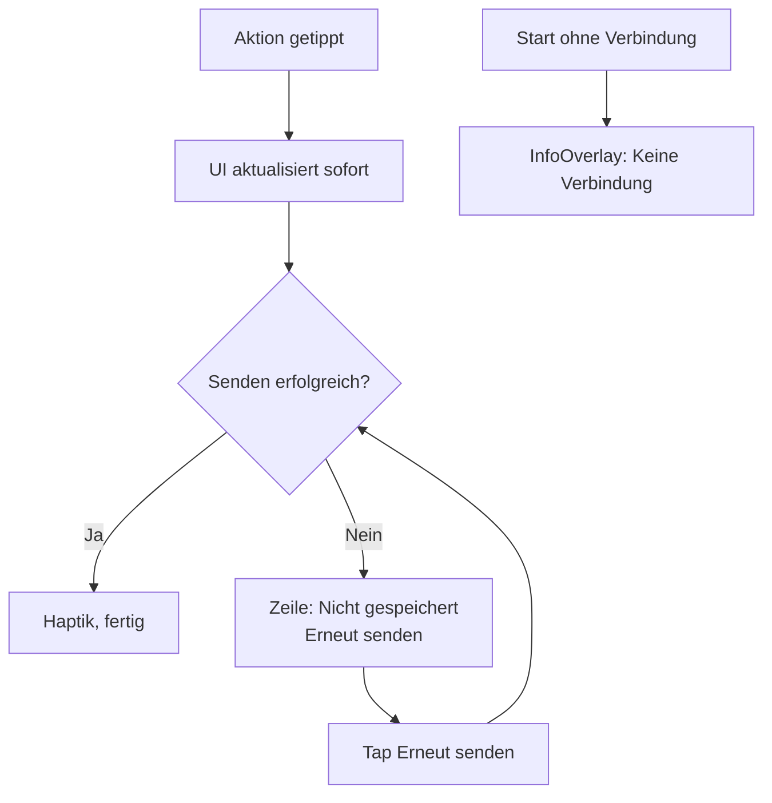
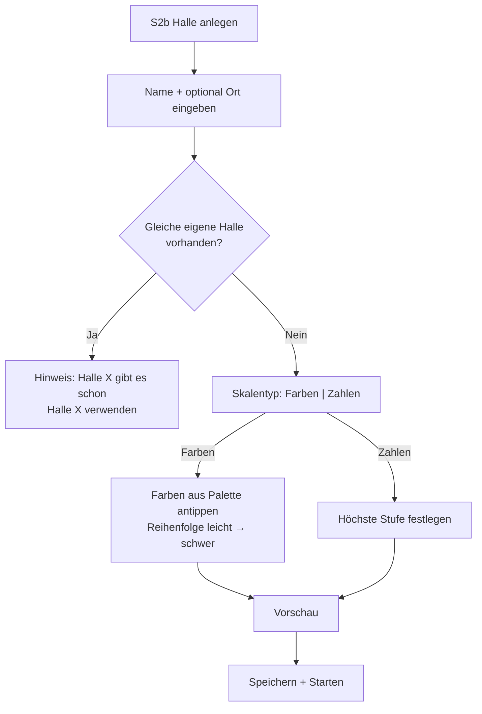

# Konzept Training / Bouldern: Klickfolgen

Stand: 16.11.2026  
Ergänzt: [KONZEPT_01_Produktkonzept.md](KONZEPT_01_Produktkonzept.md), Screens: [KONZEPT_03_Screens.md](KONZEPT_03_Screens.md)

Legende: Rechtecke = Screens, Rauten = Entscheidungen, Zahlen am Pfeil = Tap-Zähler ab Tab `Training`. Screen-IDs (`S1` ...) verweisen auf die Wireframes.

---

## 1. Gesamtnavigation

```mermaid
flowchart LR
    subgraph Tabs
        H[Home]
        E[Ernährung<br/>Segment Tagebuch / Rezepte]
        T[Training]
        P[Progress]
        PR[Profil]
    end
    H -- Karte "Bouldern läuft" --> S3
    T --> S1[S1 Training-Hub]
    S1 --> S2[S2 Halle wählen]
    S1 --> S3[S3 Erfassung]
    S1 --> S9[S9 Verlauf]
    S1 --> S10[S10 Projekte]
    S2 --> S2b[S2b Halle anlegen]
    S2 --> S3
    S3 --> S4[S4 Details-Sheet]
    S3 --> S5[S5 Projekte-Sheet]
    S3 --> S6[S6 Beenden-Sheet]
    S6 --> S7[S7 Zusammenfassung]
    S9 --> S7
    S9 --> S8[S8 Nachtrag anlegen]
    S8 --> S3
    S10 --> S11[S11 Projekt-Detail]
```

---

## 2. Session starten (bekannte Halle) — 2 Taps



Variante mit Home-Schnellstart-Karte (PO-C, nur an einem Bouldern-Trainingstag ohne Session heute): `Home` → `Starten` = **1 Tap**.

---

## 3. Erste Session / andere Halle



Tap-Zähler mit vorhandener eigener Halle: Tab, `Starten`, Halle wählen, `Starten` = 3 bis 4 Taps (siehe Budget).

---

## 4. Hauptschleife: Boulder erfassen



Beispiele:

| Fall | Taps |
|---|---|
| Gelb im ersten Versuch | Stufe `Gelb`, `Geschafft` = **2** |
| Gelb nach 5 Versuchen (Standardfall) | `Gelb`, Chip `5`, `Geschafft` = **3** |
| Rot 5x versucht, nicht geschafft | `Rot`, Chip `5`, `Offen` = **3** |
| Gelb, gezählt nach jedem Versuch (3 Versuche) | `Gelb`, `+`, `+`, `Geschafft` = **4** |
| Danach nochmal Gelb, sofort geschafft | `Geschafft` = **1** (Stufe bleibt) |
| Rot versucht, nicht geschafft, dann Gelb | `Rot`, `Offen`, `Gelb`, `Geschafft` = **4** |

---

## 5. Korrigieren und Löschen



Das Details-Sheet erzwingt konsistente Werte (Flash nur bei genau 1 Versuch, siehe Produktkonzept 5.3).

---

## 6. Projekt anlegen und fortsetzen



Projekt fortsetzen = `Projekte`, Projekt, Aktion = **3 Taps**.

Projekt aufgeben (Boulder abgeschraubt): `Tab Training` → `Projekte` → Projekt → `Archivieren` → `ConfirmSheet` bestätigen.

---

## 7. Session beenden



Gibt es keinen Eintrag, bietet das Sheet `Session verwerfen` statt `Session beenden` an.

---

## 8. Nachträgliche Session



---

## 9. Vergessene Session



---

## 10. Fehler und Verbindungsverlust (ohne Offline, PO-2)



---

## 11. Anlage einer eigenen Halle


